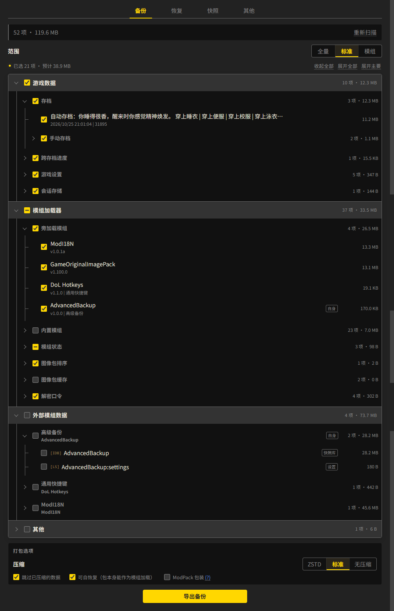

**简中** | [English](README_EN.md)

# 高级备份

为 [Degrees of Lewdity](https://gitgud.io/Vrelnir/degrees-of-lewdity) 提供完整的备份与恢复功能：将游戏数据、模组包与排序、外部模组数据打包成一个 zip，在恢复时原样还原。

- 依赖：ModLoader >= 2.1.0
- 目标版本：DoL 0.5.12.13（跟随最新汉化版本）
- 理论兼容：DoL >= 0.4.2.7（实测 `0.4.2.7` `0.5.0.5` `0.5.6.10`）
- 因游戏自身存储结构变动，在跨版本恢复数据时引发的问题不在本模组的维护范围内

## 功能

### 入口

模组入口位于「存档」窗口中 `高级备份` 标签页。

### 备份

以分组树的形式列出本机上的数据。提供四个预设选项可快速选择，也可以自由勾选项目以设置备份范围。最终导出一份包含所选数据的 `.zip` 备份包。

- 分组树：游戏数据（存档 / 成就 / 设置）、模组加载器（模组包 / 排序 / 状态 / 图像包）、外部模组数据、其他
- 预设范围：**全量** / **标准** / **模组** / **自定义**；
- 三档压缩：**标准**（浏览器原生 deflate）/ **无压缩** / **ZSTD**（体积最小）
- 自恢复包：导出包本身就是一份模组，作为模组安装后重载即可恢复数据，适用于在没有此模组的设备上进行恢复。
- ModPack 包装：用于避开 ModLoader 2.60.0 及以上版本的完整性校验上限，使超大（120 MiB 以上）模组可被正常加载。

### 恢复

具备与备份一致的分组树，允许自由勾选决定恢复的数据范围。

本模组提供四种数据恢复模式：`合并`、`覆盖`、`补缺`、`干净`，具体的语义细则见下表：

| 数据 | 合并 | 覆盖 | 补缺 | 干净 |
| --- | --- | --- | --- | --- |
| 自动存档、旧式存档 | 覆盖勾选的 | 覆盖勾选的 | 本机没有才写 | 只留勾选的 |
| 手动存档 | 覆盖勾选的 | 只留勾选的 | 本机没有才写 | 只留勾选的 |
| 成就与解锁 | 合并：取更早、并集、较大 | 覆盖勾选的 | 合并：取更早、并集、较大 | 只留勾选的 |
| 剧情标记、世界快照 | 覆盖勾选的 | 覆盖勾选的 | 本机没有才写 | 只留勾选的 |
| 游戏设置、会话存储 | 覆盖勾选的 | 覆盖勾选的 | 本机没有才写 | 只留勾选的 |
| 模组包 | 覆盖勾选的 | 只留勾选的 | 本机没有才写 | 只留勾选的 |
| 模组顺序、禁用列表 | 并集，以本机顺序为基准 | 完全替换为包内 | 并集，以本机顺序为基准 | 完全替换为包内 |
| 图像包排序 | 合并数组，以本机顺序为基准 | 整库替换为包内 | 合并数组，以本机顺序为基准 | 整库替换为包内 |
| 解密口令 | 覆盖勾选的 | 只留勾选的 | 本机没有才写 | 只留勾选的 |
| 外部模组数据、其他 | 覆盖勾选的 | 覆盖勾选的 | 本机没有才写 | 只留勾选的 |

### 快照

保存本机当前的数据，作为兜底措施，与备份包共用相同的结构。

- **自动**：每次恢复前自动创建，固定 3 个滚动位
- **手动**：数量不限，可改名、导出为 zip、删除、直接作为恢复来源

## 界面



## 映射表 API

外部模组数据默认落在「其他」，并按域名分组。注册一条映射后，该模组的 localStorage 键与 IndexedDB 库会单独成组，显示名由映射给出。注册只影响分组与显示，不改变数据本身与地址。

```js
window.AdvancedBackup.mapping.register({
  mod: 'MyMod',
  label: { zh: '我的模组', en: 'My Mod' },
  keys: ['mymod.settings', /^mymod\.cache\./],
  dbs: ['mymod-db'],
});
```

- `mod`：身份，与 boot.json 的 `name` 或任一 `alias` 全等即命中；分组路径为 `moddata/<mod>`。
- `label`：字符串按原文显示；需要跟随界面语言时写 `{ zh, en }`。
- `keys` / `sessionKeys` / `dbs`：规则可以是全等字符串、正则，或 `{ match, badge }`。`badge` 是行上的用途标签，同样只影响显示。三项至少要有一项。
- 同 `mod` 重复注册时，后一条整条覆盖前一条。结构不合法的条目被丢弃并在控制台告警，其余条目照常生效；`register()` 返回 `false` 表示有条目被丢弃。
- 求值顺序：包内映射 → 已注册条目 → 内置表，首条命中负责。
- `mapping.list()` 返回当前生效的表，是副本，就地改动不影响内部状态。

调用时机早于本模组加载时（同为 `inject_early` 阶段），先把条目放进 `window.AdvancedBackupMapping`，本模组启动时读取并注册：

```js
window.AdvancedBackupMapping ??= [];
window.AdvancedBackupMapping.push({ mod: 'MyMod', label: 'My Mod', keys: ['mymod.settings'] });
```
