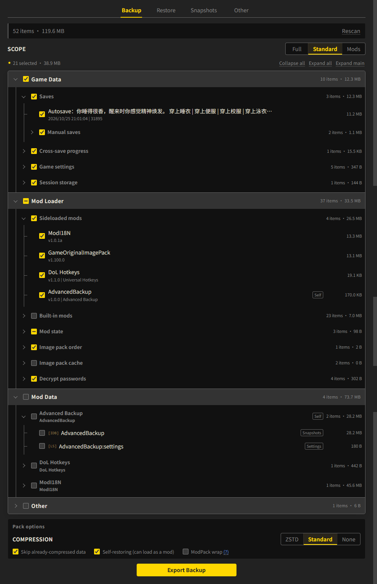

[简中](README.md) | **English**

# Advanced Backup

Full backup and restore for [Degrees of Lewdity](https://gitgud.io/Vrelnir/degrees-of-lewdity): pack game data, mod packs and load order, and external mod data into one zip, then restore it as-is.

- Requires: ModLoader >= 2.1.0
- Target version: DoL 0.5.12.13 (follows the latest localized build)
- Theoretical compatibility: DoL >= 0.4.2.7 (tested on `0.4.2.7` `0.5.0.5` `0.5.6.10`)
- Problems caused by changes in the game's own storage structure when restoring data across versions are outside this mod's maintenance scope

## Features

### Entry

The mod adds an `Advanced Backup` tab to the Saves window.

### Backup

Lists the data on this machine as a grouped tree. Four check presets make selection quick, and you can also check
items freely to set the backup scope. The result is a `.zip` containing the selected data.

- Groups: Game Data (saves / feats / settings), Mod Loader (mod packs / order / state / image packs), external mod data, other
- Presets: **Full** / **Standard** / **Mods** / **Custom**
- Three compression levels: **Standard** (native browser deflate) / **None** / **ZSTD** (smallest)
- Self-restoring pack: the exported pack is itself a mod. Install it as a mod and reload to restore the data, which suits restoring on a device without this mod.
- ModPack wrap: avoids the integrity-check limit in ModLoader 2.60.0 and later, so very large mods (120 MiB and above) load correctly.

### Restore

The tree is the same as in Backup, and you can check items freely to set the restore scope.

Four restore modes are available: `Merge`, `Overwrite`, `Fill` and `Clean`. Their exact semantics are in the table below.

| Data | Merge | Overwrite | Fill | Clean |
| --- | --- | --- | --- | --- |
| Auto saves, legacy saves | Overwrite the selected | Overwrite the selected | Write only if missing | Keep only the selected |
| Manual saves | Overwrite the selected | Keep only the selected | Write only if missing | Keep only the selected |
| Feats | Merge: earlier date, union, larger | Overwrite the selected | Merge: earlier date, union, larger | Keep only the selected |
| Story flags, world snapshots | Overwrite the selected | Overwrite the selected | Write only if missing | Keep only the selected |
| Game settings, session storage | Overwrite the selected | Overwrite the selected | Write only if missing | Keep only the selected |
| Mod packs | Overwrite the selected | Keep only the selected | Write only if missing | Keep only the selected |
| Mod order, disabled list | Union, local order first | Replace with the pack's copy | Union, local order first | Replace with the pack's copy |
| Image pack order | Merge arrays, local order first | Replace the record with the pack's copy | Merge arrays, local order first | Replace the record with the pack's copy |
| Decrypt passwords | Overwrite the selected | Keep only the selected | Write only if missing | Keep only the selected |
| External mod data, other | Overwrite the selected | Overwrite the selected | Write only if missing | Keep only the selected |

### Snapshots

Saves the current data on this machine as a fallback measure. Snapshots share the same structure as backup packs.

- **Automatic**: created before every restore, 3 rolling slots
- **Manual**: unlimited; can be renamed, exported as a zip, deleted, or used directly as a restore source

## Interface



## Mapping API

External mod data falls under "Other" by default, grouped by host. Register a mapping entry and the mod's localStorage keys and IndexedDB databases get a group of their own, with the display name from the entry. A mapping only affects grouping and display. It does not change the data or the address.

```js
window.AdvancedBackup.mapping.register({
  mod: 'MyMod',
  label: { zh: '我的模组', en: 'My Mod' },
  keys: ['mymod.settings', /^mymod\.cache\./],
  dbs: ['mymod-db'],
});
```

- `mod`: the identity. It matches the boot.json `name` or any `alias` exactly. The group path is `moddata/<mod>`.
- `label`: a string is shown as written; use `{ zh, en }` if the name must follow the interface language.
- `keys` / `sessionKeys` / `dbs`: a rule is an exact string, a regular expression, or `{ match, badge }`. `badge` is the purpose tag on the row, and it also only affects display. Supply at least one of the three fields.
- Registering the same `mod` again replaces the whole entry. An entry with an invalid structure is dropped with a console warning, and the other entries still apply; `register()` returns `false` when any entry was dropped.
- Evaluation order: pack mapping, then registered entries, then the built-in table. The first match wins.
- `mapping.list()` returns the effective table as a copy. Changing it in place does not affect the internal state.

If the call runs before this mod loads (both scripts use `inject_early`), push the entry into `window.AdvancedBackupMapping` instead. This mod reads the queue at startup and registers it:

```js
window.AdvancedBackupMapping ??= [];
window.AdvancedBackupMapping.push({ mod: 'MyMod', label: 'My Mod', keys: ['mymod.settings'] });
```
